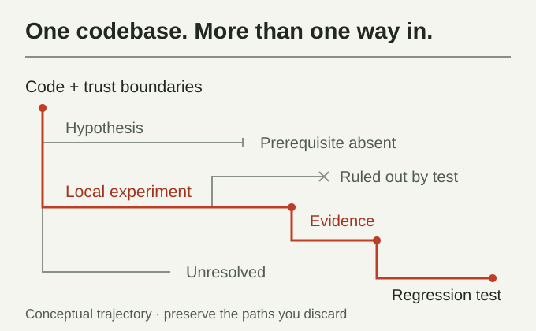

<h1> How Could I Be Hacked</h1>

Explore how your code could be attacked using real security investigation trajectories.
Find applicable hypotheses, run targeted checks, and turn verified findings into regression
tests — all locally, without API access.

**23 cases · 75 steps · 437 searchable hypothesis entries**

**Works offline. No API keys required.**

The public corpus and its original examples are available under the [MIT License](library/LICENSE).

[Install](#install-the-skill) · [Use with an agent](#use-with-an-agent) · [Run locally](#run-locally) · [Workflow](references/workflow.md)

## Install the skill

Run this command to install with the Skills CLI:

```sh
npx skills add sandhiveio/How-Could-I-Be-Hacked --skill how-could-i-be-hacked
```

Python 3.10+ with SQLite FTS5 is required. No third-party Python packages or API keys are needed.

Then [ask your agent to review your repository](#use-with-an-agent).



[View investigation map at full size](assets/illustrations/investigation-cover.svg)

## Corpus coverage

- **Python and JavaScript libraries and web components.** Reproduction and regression
  checks cover SQL injection, SSRF, path traversal, prototype pollution, HTTP request
  smuggling, redirect credential leaks, JWT algorithm confusion, and regex denial of service.
  The redirect checks include proxy credentials across multiple hops and equivalent origins.
- **Tool-using assistants.** Indirect prompt injection investigations cover payments,
  travel booking, calendars, and messaging. They track the injected objective and
  legitimate task separately.
- **Data anonymization CLI.** Checks cover consistent pseudonyms across linked
  tables and time-dependent identities under a memory limit.

- **Authorization, rendering, and tooling.** Checks cover streaming RPC authentication,
  path-dependent authorization caching, HTML template autoescaping, secret redaction
  in logs, Git clone option validation, and line-ending differences between YAML template
  parsing and signature verification. Additional trajectories cover entity-encoded URI schemes
  in HTML sanitizers and revocation of existing session tokens when an account is disabled.

Additional CSRF checks cover token collapse onto a constant across memory and session
stores, with double-submit, extraction-source, and single-use replay controls.

Planned coverage includes archive symlinks, session handling, and cryptography
challenges. The queue also includes release provenance, sanitizer
compatibility, and behavioral replay.

## Spend fewer tokens. Reuse investigation paths.

Start from reusable investigation trajectories instead of rebuilding every hypothesis and test
plan from scratch. Retrieve a relevant mechanism, check its prerequisites against your code,
and adapt the existing test approach. This can save agent tokens and investigation time.

Use the library as a security review checklist: compare applicable attack paths, revisit
rejected alternatives, and add checks for overlooked trust boundaries and edge cases.
Build on previous investigations to cover more attack paths and reach useful results faster.
In our benchmarks, reusing investigation trajectories reduced token usage by 20% and sped up
case resolution.

## Use with an agent


[View workflow at full size](assets/illustrations/investigation-workflow.svg)

For manual installation, copy or clone this repository into a folder named `how-could-i-be-hacked`
inside your agent's skills directory, or give your agent the absolute path to [SKILL.md](SKILL.md).

Example request:

> Use $how-could-i-be-hacked to review my authorized local repository. Retrieve relevant
> hypotheses, check their applicability to the code, run bounded local tests, and add
> regression checks for verified findings. Keep the evidence in a private folder.

## Run locally

```sh
python scripts/toolkit.py stats
python scripts/toolkit.py verify
python scripts/corpus.py search --library library --query "path traversal symlink containment" --limit 5
python scripts/test_toolkit.py
```

See [workflow commands](references/workflow.md) and the [offline iteration protocol](references/iteration.md)
for inspecting trajectories, recording assessments and validating completed steps.
On Windows without a native Python installation, run these commands using Python in WSL.

## What is included

- Anonymous cases with independently readable investigation steps.
- Local lexical search, full trajectory inspection and artifact hash verification.
- Iterative planning, candidate evaluation, incumbent comparison and backtracking guidance.
- Private assessment scaffolding and evidence/step validation.

These counts describe the bundled snapshot; `stats` reports the current contents. Historical
outcomes are evidence about their source cases, not proof of a vulnerability in your code.
Search is lexical, not semantic, and cannot establish the absence of vulnerabilities.
The toolkit assists an agent; it does not autonomously scan code or execute retrieved text.

## Data and evidence

Snapshot updated November 8, 2026. Daily updates are planned once the pipeline is configured.

The library is a snapshot of the project's curated local library. Raw producer runs, private
identity mappings and credentials are excluded. Do not commit assessments or target logs here.
The offline consumer does not call a generation API. Producing new corpus trajectories is a
separate workflow. The bundled corpus runtime preserves the source implementation, except for
using offline-only JSON helpers instead of importing the producer module.

Hash checks detect corruption; they do not establish authenticity or validate security claims.
Use only within the target's actual authorized scope and permissions.

## Contact

- GitHub: [sandhiveio](https://github.com/sandhiveio)
- Website: [SandHive](https://sandhive.io)
- Telegram: [@sandhive](https://t.me/sandhive)
