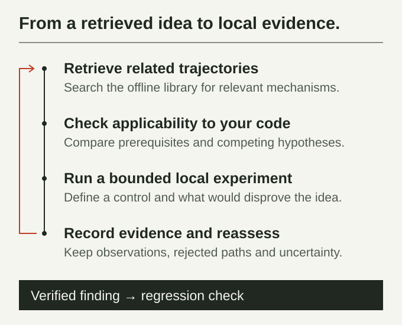

<h1> How Could I Be Hacked</h1>

**Give your coding agent real security investigations to draw on during code review.**

Search for cases that match the code you are reviewing. See which hypotheses were tried, what
the checks showed, and which alternatives were set aside. Use that context to design local checks
and turn confirmed findings into regression tests.

**37 anonymized cases · 113 investigation and review steps · 475 search entries**

The library and search tools run locally with Python and SQLite. No API key required.

[Quickstart](#quickstart) · [Case catalog](#case-catalog) · [How it works](#how-it-works) · [Command reference](references/workflow.md)

## Quickstart

### Use with a coding agent

Install with the [Skills CLI](https://github.com/vercel-labs/skills#install-a-skill).

```sh
npx skills add sandhiveio/How-Could-I-Be-Hacked --skill how-could-i-be-hacked
```

Paste this prompt into your agent from the repository you are authorized to review.

> Use $how-could-i-be-hacked to review this repository. Find cases that match the code,
> explain which checks apply, and add regression tests for any findings you confirm locally.
> Save review notes and evidence privately.

For manual setup, copy the full repository into your agent's skills directory under
`how-could-i-be-hacked`, or point your agent at [SKILL.md](SKILL.md).

### Search the library directly

Run the search from a local copy of this repository.

```sh
python scripts/corpus.py search --library library --query "credential masking formatter" --limit 5
```

This search surfaces hypotheses from the log redaction case, with the context and historical
evaluation for each match. The local tools require **Python 3.10+ with SQLite FTS5** and use the
Python standard library. On Windows you can also run them in WSL.

## Case catalog

Each link opens the anonymized case context. The last column counts the recorded investigation
steps. You can inspect their evidence and decisions with the [trajectory command](references/workflow.md).

| Case | Review focus | Steps |
| --- | --- | ---: |
| [SQL injection in EXPLAIN options](library/cases/case-00bfea1eea0547a49214fd10f10b0e46/case.json) | Validation of database-specific query options | 2 |
| [Outbound request destination](library/cases/case-4871606bc3624b0e83ffa3f6e7c95ec6/case.json) | Origin enforcement when an HTTP client resolves a request path | 4 |
| [HTTP credentials on redirects](library/cases/case-9f9094d375ad4f4198e6a3c43257d3a5/case.json) | Credential handling across origin and protocol changes | 5 |
| [Proxy credentials on HTTP redirects](library/cases/case-5a760d5425434351b506692f92a6ae08/case.json) | Proxy credential isolation across redirect hops | 4 |
| [HTTP request smuggling](library/cases/case-12b764f81331452fad88878ec0ab915b/case.json) | Validation of HTTP/1.1 chunk boundaries | 4 |
| [Static-file path traversal](library/cases/case-702a9739c1f34802a415de3b9fdc7a19/case.json) | Filesystem containment in a static-file handler | 3 |
| [Cookie parser denial of service](library/cases/case-a15710c157ac4ca08718fbbe62bf3464/case.json) | Parsing time for malformed cookie headers | 4 |
| [CSRF token validation](library/cases/case-848c1c44088843f38fba5e0a8b3d1514/case.json) | Token generation and validation across memory and session stores | 2 |
| [JWT algorithm confusion](library/cases/case-a5bb55a6d823483091324c515e32ed48/case.json) | Compatibility checks between verification algorithms and key types | 4 |
| [Streaming RPC authentication](library/cases/case-065db678c4664fbc8b35adc66a7264e0/case.json) | Consistent authentication on unary and streaming requests | 2 |
| [Authorization cache correctness](library/cases/case-9fc62583c0044d909212d96b60979f7c/case.json) | Cache behavior in recursive permission checks | 4 |
| [Session revocation](library/cases/case-47e872f11dcc4421947ad049b5018bf8/case.json) | Handling of existing session tokens after an account is disabled | 4 |
| [Template autoescaping](library/cases/case-352c68ac2de543b09a2ff81f8c6e1b97/case.json) | Escaping of user data in templates and layouts | 4 |
| [URI validation in HTML sanitizers](library/cases/case-37ac0f7032f142dcb0e40f0734eeca65/case.json) | Scheme validation for HTML attributes | 4 |
| [Prototype pollution](library/cases/case-9eff46a29dde40eeb42ac3908df4cf0f/case.json) | Property-path validation in a JavaScript setter | 2 |
| [Secret redaction in logs](library/cases/case-8febf1af62cd40e6ba9dfea83f4728cd/case.json) | Credential masking across application and SDK loggers | 4 |
| [Git clone option validation](library/cases/case-948d24148ef34a42bb237bacab065fdb/case.json) | Validation of arguments passed from a library to Git | 4 |
| [Signed YAML templates](library/cases/case-4c1b4593177d4f3289377f152128add4/case.json) | Agreement between signature verification and template parsing | 2 |
| [Pseudonyms across linked tables](library/cases/case-21af815d7a4e4c8991c6286eb15deff9/case.json) | Consistent pseudonyms across related CSVs and historical records under a memory limit | 4 |
| [Prompt injection in payment workflows](library/cases/case-aa4888d8314d483498a59f9167f749c5/case.json) | Transfer authorization when an assistant reads a bill | 2 |
| [Prompt injection in travel booking](library/cases/case-3204b3a58c41492e824878008054e084/case.json) | Reservation scope when an assistant reads hotel reviews | 3 |
| [Prompt injection in calendar workflows](library/cases/case-7e8b17932d2b4018ae2513dd56b953c4/case.json) | Calendar edit scope when an assistant reads event descriptions | 2 |
| [Prompt injection in messaging workflows](library/cases/case-fce6af02155649cfb97771c91053dd0b/case.json) | Message-send authorization when an assistant reads a webpage | 2 |

### Defensive review examples

These indexed cases include independent steps with a security invariant, a regression
assertion, and a generalized source observation. For a compact walkthrough, open the
[defensive review guide](library/checks/defensive-review-examples.md).

| Case | Review focus | Steps |
| --- | --- | ---: |
| [OIDC client-secret redaction](library/cases/case-04fad4b46561488bbf37094f98092b45/case.json) | Mask provider secrets in copies used by logs and management responses | 2 |
| [OIDC group membership](library/cases/case-1392ecdfbe2744d59acddd5bb54bc0d7/case.json) | Require verified membership before forwarding configured groups | 2 |
| [List query fields and sorting](library/cases/case-5186db661bde48a4b7b6e120c220807e/case.json) | Validate filter and sort fields and preserve bound values | 4 |
| [Release artifact visibility](library/cases/case-5c4667fb970b4684ac569c5bb5a27533/case.json) | Apply source policy to shipped bundles, maps, and provenance | 4 |
| [Upload destination containment](library/cases/case-88fc403c29eb4697adbfc2d944b682fe/case.json) | Enforce containment across framework uploads and direct writes | 4 |
| [Outbound discovery requests](library/cases/case-ae1bcf4332314a34bb6b744ce76ce790/case.json) | Enforce destination policy and deadlines across redirects | 2 |
| [Account-level sign-in limits](library/cases/case-c8fc66ccf2d440e3be2947fa8e645302/case.json) | Share the failed-sign-in budget across supported account identifiers | 2 |
| [Archive extraction containment](library/cases/case-ce0f488a2ad64314a3eccd04cf2d7e9c/case.json) | Confine writes and link operations to the extraction root | 4 |
| [Transcoder process arguments](library/cases/case-e09ae020c2784f2daff359ad12e026bd/case.json) | Preserve argument boundaries and documented wrapper behavior | 2 |
| [Authorization model changes](library/cases/case-f2edf20fff384048b52a38a3e0543577/case.json) | Evaluate stored relationships under the selected model | 4 |
| [Command guardrail policy](library/cases/case-39aef9b172ae403da6e796a4b755c352/case.json) | Classify version-control operations by parsed command and arguments | 2 |
| [API key scope and expiry](library/cases/case-9f116dc1f30c4596bf3fdd822a0ea1fc/case.json) | Require recognized write scope and check expiry when binding a key | 2 |
| [Tool session state isolation](library/cases/case-91c305520511418684a92f3ecdd93b40/case.json) | Keep default event identifiers, parent links, and resets session-scoped | 2 |
| [HTML filter parsing boundaries](library/cases/case-a44f1591d7e8488985a2059af25b4914/case.json) | Preserve benign markup and enforce element and attribute policy at parser boundaries | 2 |

## How it works

1. **Search by mechanism.** The SQLite index looks for any of your query terms in case context
   and candidate hypotheses. Try synonyms when a query misses the terms used in the corpus.
2. **Read the evidence.** Investigation steps include candidate evaluations and the observation
   for the selected check. Defensive review steps include an invariant, a regression assertion,
   and a generalized source observation. Use the trajectory command to read the steps in order.
3. **Apply the relevant checks.** Compare the case's assumptions with your own code and collect
   fresh evidence before reporting a finding. Keep assessments private and work within the
   repository's authorized scope.

[](assets/illustrations/investigation-workflow.svg)

[View the branching investigation map](assets/illustrations/investigation-cover.svg).

## Library and tools

```sh
python scripts/toolkit.py stats
python scripts/toolkit.py verify
python scripts/test_toolkit.py
```

`stats` reports the contents of the installed snapshot. `verify` checks artifact hashes and SQLite
integrity. See the [library format](library/README.md), [command reference](references/workflow.md),
and [offline iteration protocol](references/iteration.md) for trajectory inspection and private
assessment validation.
Maintainers can check publication coverage with the [case audit](references/workflow.md#publication-audit).

The [public corpus and its original examples](library/LICENSE) are available under the MIT License.
The snapshot contains anonymized artifacts. Raw runs and private case mappings stay with the
producer.

## Contact

- [SandHive on GitHub](https://github.com/sandhiveio)
- [SandHive website](https://sandhive.io)
- [@sandhive on Telegram](https://t.me/sandhive)
